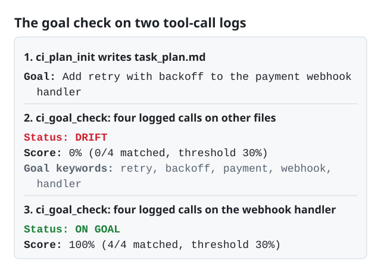
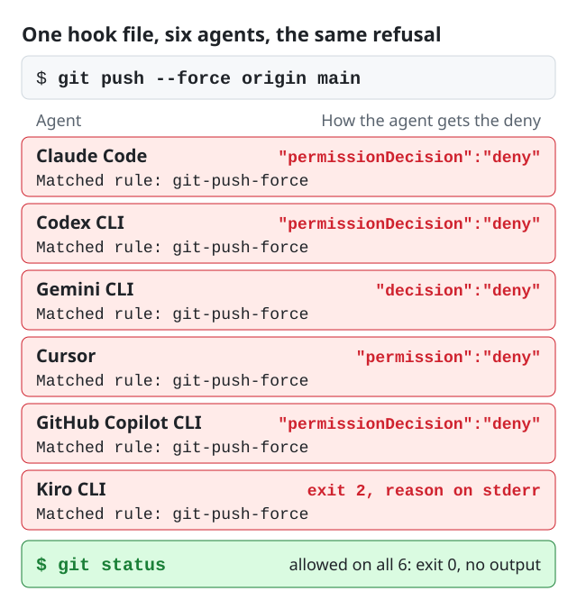
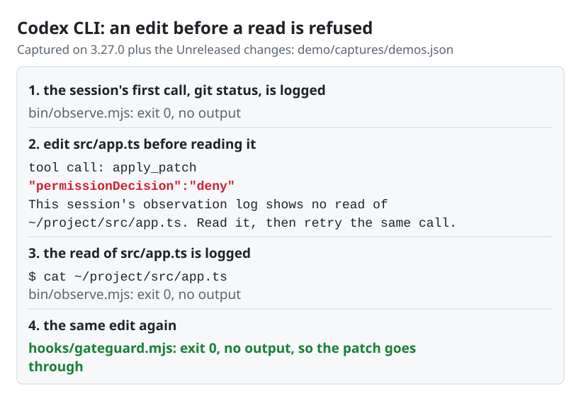
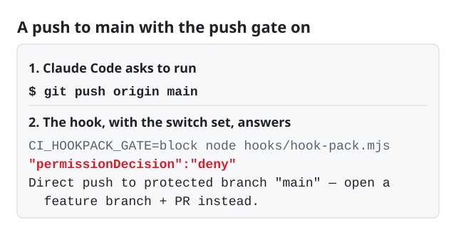
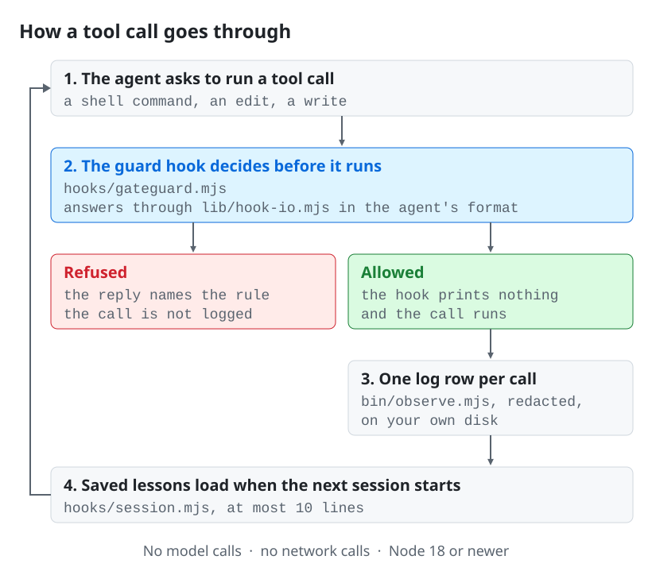
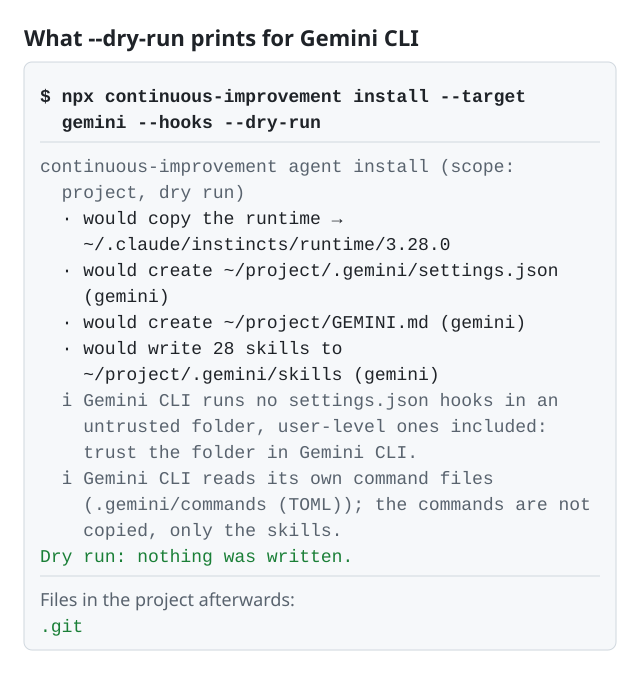
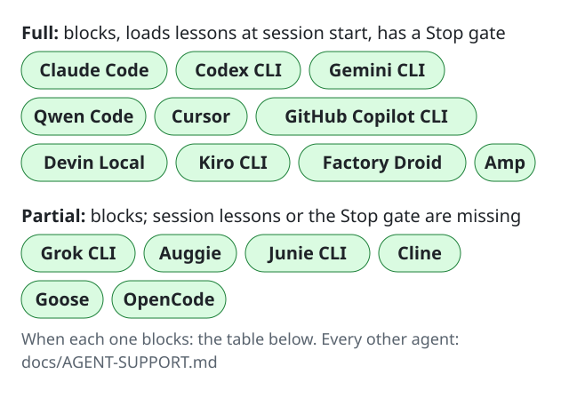
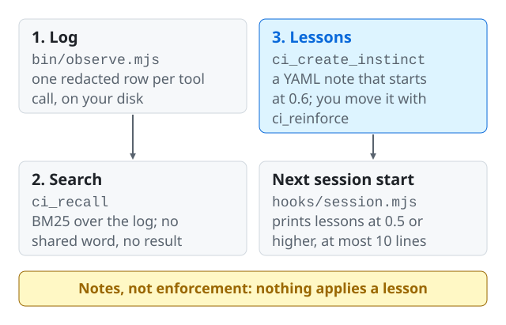
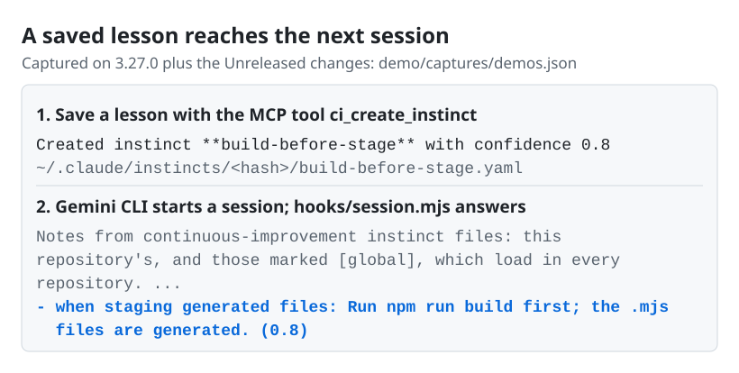
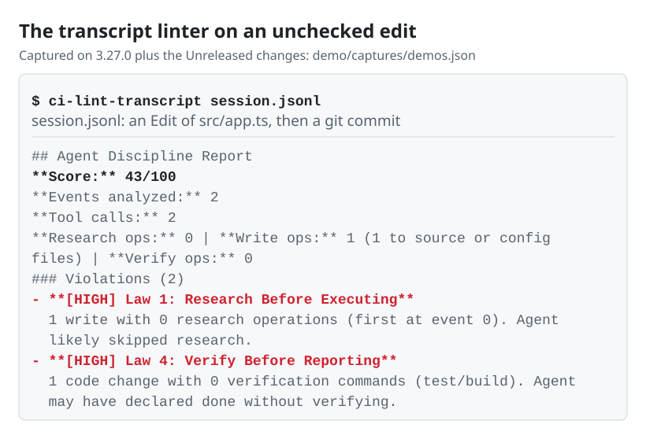

<!-- README structure rationale: docs/plans/2026-11-25-two-pillars.md. Superseded structures: docs/plans/2026-11-22-readme-all-agents.md, docs/plans/2026-11-20-frontier-model-refresh.md, docs/plans/2026-08-22-readme-still-useful.md, docs/plans/2026-06-28-readme-progressive-disclosure.md. -->

# continuous-improvement

**Aim high. Stay in control.** Two pillars, ambition and discipline, and one working loop, installed into the coding agent you already use.

[](https://www.npmjs.com/package/continuous-improvement) [](https://www.npmjs.com/package/continuous-improvement) [](https://github.com/marketplace/actions/ai-agent-discipline-linter) [](LICENSE)

| Ambition: you have big goals | Discipline: you control the AI |
|---|---|
| The `be-ambitious` skill tells the agent to work on the goal behind the task, with a target and a check set before it starts. | With the hooks installed, [`hooks/gateguard.mjs`](hooks/gateguard.mjs) refuses destructive commands and edits of existing files the session has not read. [`bin/observe.mjs`](bin/observe.mjs) logs each call that runs. Stricter gates are switches you set. |
| A skill: guidance the agent reads. No hook checks that it was followed. | Hooks: Node scripts on your machine. No model calls, no network calls. |

What is enforced, step by step: [The loop](#the-loop). What it cannot do: [Limits](#limits).

```bash
# in your project's git repository (add --dry-run to preview)
npx continuous-improvement install --target <agent> --hooks
```

`<agent>` is `codex`, `gemini`, `qwen`, `cursor`, `copilot`, `grok`, `devin`, `kiro`, `droid`, `auggie`, `junie` (add `--scope user`), `cline`, `goose`, `opencode` or `amp`. Claude Code installs it as a plugin ([Install](#install)).

It works in 16 coding agents: Claude Code, Codex CLI, Gemini CLI, Qwen Code, Cursor, GitHub Copilot CLI, Grok CLI, Devin Local, Kiro CLI, Factory Droid, Auggie, Junie CLI, Cline, Goose, OpenCode and Amp. Each has its own setup step and its own gaps ([agent table](#works-with-these-agents)).

<p><br><sub>Ambition sets the goal. The loop is how the work gets done. The marks say what code backs each step.</sub></p>

Walkthrough: [QUICKSTART.md](QUICKSTART.md). Every agent's details: [docs/AGENT-SUPPORT.md](docs/AGENT-SUPPORT.md). Site: [continuous-improvement.dev](https://continuous-improvement.dev). Changes: [CHANGELOG.md](CHANGELOG.md).

## The loop

Seven steps, in the order the work happens. The third column is what the agent is told. The fourth is what code does, and where it says "None" no hook runs.

<!-- loop-table:start -->
| Step | Law | What the agent is given | What a hook does |
|---|---|---|---|
| 1. Research | Law 1, Research Before Executing | The rule: find what exists, the constraints and what can break before acting. Skills `recall`, `reconcile`, `grill-me`, `roast`. The `ci_recall` MCP tool searches the log when called | **Refuses by default.** [`hooks/gateguard.mjs`](hooks/gateguard.mjs) denies an edit of an existing file when the session's log shows no read of it. It checks that one thing. Switch: `CI_GATEGUARD_FILE_GATE=off` |
| 2. Plan | Law 2, Plan Is Sacred | The rule: state what you will build, what you will not, how you will verify, and the fallback. `be-ambitious` tells the agent to set the goal and a target first. `ci_plan_init` writes `task_plan.md`, and `ci_goal_check` scores recent calls against its `## Goal` | **Off until you switch it on.** [`hooks/goal-drift-stop.mjs`](hooks/goal-drift-stop.mjs) with `CI_GOAL_DRIFT_GATE=block` sends a drifted wrap-up back. Shown to work on Claude Code only: it reads the reply from a Claude Code transcript. No hook requires a plan before the first edit |
| 3. Implement | Law 3, One Thing at a Time | The rule: finish and verify one task before the next. Skills `tdd-workflow`, `ship`, `worktree-safety` | **Refuses by default.** [`hooks/gateguard.mjs`](hooks/gateguard.mjs) denies destructive commands on every matching call, with no switch. With `CI_HOOKPACK_GATE=block`, [`hooks/hook-pack.mjs`](hooks/hook-pack.mjs) denies a push to `main`, `master` or `release/*` and a commit staging more than 15 files. No hook checks "one thing at a time" itself |
| 4. Review | Law 4, Verify Before Reporting | The rule: done means the code ran and the result was checked. Skills `verification-loop`, `simplicity-review`, `audit` | **Off until you switch it on.** [`hooks/typecheck-stop.mjs`](hooks/typecheck-stop.mjs) with `CI_TYPECHECK_GATE=block` holds the turn open on a failing typecheck. TypeScript only, on the 12 agents with a Stop gate (a hook that runs when the agent ends its turn and can send it back). No hook runs tests, lint or a build. After the run, the [transcript linter](#unattended-runs-and-ci) flags a code change with no test or build command |
| 5. Contemplate | Law 5, Reflect After Every Session | The reflection block: what worked, what failed, what to do differently, the rule to add, the next three moves. The `ci_reflect` MCP tool returns the template and stores nothing | **None.** A written rule |
| 6. Relearn and learn | Law 7, Learn From Every Session | Lessons you or the agent save with `ci_create_instinct` and strengthen or weaken with `ci_reinforce`. Skill `skill-distillation` | **Records and loads.** [`bin/observe.mjs`](bin/observe.mjs) logs each tool call that runs. [`hooks/session.mjs`](hooks/session.mjs) prints up to 10 saved lessons at session start (`CI_INSTINCT_LOAD=off` stops it): by hook on 11 agents, through a rules file you rewrite on 4, not at all on 1. Nothing saves, applies or fades a lesson for you |
| 7. Iterate | Law 6, Iterate Means One Thing | The rule: one change, verify, next change. The three next moves from step 5 start the next pass | **None.** Nothing in the session. After a run, the [transcript linter](#unattended-runs-and-ci) flags more than 8 files edited |

How to read the last column. **Refuses by default**: a hook answers deny before the call runs. **Off until you switch it on**: the hook ships and refuses nothing until you set the variable. **Records and loads**: a hook writes a log row or prints saved lessons, and cannot refuse anything. **None**: text the agent is given, and nothing checks it during the session.

Reach, from the [agent table](#works-with-these-agents): the skills go to all 16 agents, the core skill with these rules among them. Codex CLI, Gemini CLI, Cursor and GitHub Copilot CLI also load the rules as a rules file in every session. 12 have a Stop gate: the 10 full-tier agents, Grok CLI and Goose. Saved lessons load by hook on 11, through a rules file you rewrite on 4 (Grok CLI, Auggie, Junie CLI and Goose), and not on Cline.
<!-- loop-table:end -->

Step 6 is the self-improvement step. The model does not change. What changes is what the next session starts with: a searchable log of what ran, and the lessons you kept.

The law numbers are the package's own and are not renumbered, so Relearn and learn is Law 7 and Iterate is Law 6. The core skill ([SKILL.md](SKILL.md)) calls steps 3, 4 and 5 Execute, Verify and Reflect, and every agent in the agent table gets it as the `continuous-improvement` skill.

## Ambition

`be-ambitious` is a bundled skill. One task goes in. The agent is told to:

1. **Climb.** Write the ladder from the task you typed to the goal behind it, then work at the highest rung its data, its access and a check can reach.
2. **Go deeper.** Use the instruments a professional in the field would use, starting from raw data.
3. **Bring other fields in.** Name the fields with something to say about the task. Give each one activity and one output. One of them attacks the result.
4. **Set the bar before the work.** A numeric target, a baseline, and a check that can fail and that the agent does not grade itself on.
5. **Report against it.** What you asked for, what was delivered, baseline to result against the target, and what broke.

The skill carries its own rules, and they are text too. What you asked for is the floor and is delivered in the form you asked for. A small task is answered directly, with none of this. Anything outward-facing or hard to reverse waits for your yes.

What is true of it:

- It is guidance the agent reads. No hook checks that the agent followed it, and this README claims no benchmark for it.
- `install --target <agent> --hooks` copies it as a skill to each of the 15 agents it installs for, and the Claude Code plugin bundles it. Ask for it by name. On Claude Code it is also the `/be-ambitious` command.
- Where an agent can run sub-agents, the fields in step 3 can run in parallel. Elsewhere they run one after another.
- The skill cannot widen what the agent may run. Where the hooks are installed, a destructive command still gets a deny from [`hooks/gateguard.mjs`](hooks/gateguard.mjs), whatever the brief says.

**Hold the goal.** Put the goal in `task_plan.md` under `## Goal` (the `ci_plan_init` MCP tool writes the file; on Claude Code, `/planning-with-files`). The `ci_goal_check` MCP tool then scores recent tool calls against it and answers ON GOAL, DRIFT or NO DATA. It scores keyword overlap, not meaning.

<p></p>

The method restates Felix Rieseberg's essay [How to be more ambitious](https://felixrieseberg.com/how-to-be-more-ambitious-a-tutorial-for-humans-with-models/) (13 October 2026). The essay coaches people who prompt models. The skill has the agent apply it to its own work.

## Discipline

You control the AI. The AI does not control you. "Full control" is the goal. Here is what you control today, in four parts, and what you do not.

### What it refuses

| Refused | Default | Change it | File |
|---|---|---|---|
| Destructive commands: `rm -rf`, `git reset --hard`, `git clean -fdx`, force pushes, `git branch -D`, `git stash drop`, `find -delete`, `DROP TABLE`, `Remove-Item -Recurse` and similar, through any shell tool. The reason names the rule that matched | On, every call | No switch: disable or uninstall | [`hooks/gateguard.mjs`](hooks/gateguard.mjs), rules in [`lib/destructive-bash.mjs`](lib/destructive-bash.mjs) |
| A blind edit: an edit of an existing file the session has not read. New files always pass, and a project with no log yet passes | On | `CI_GATEGUARD_FILE_GATE=off`; `CI_GATEGUARD_EXCLUDE=<path fragments>` skips paths | [`hooks/gateguard.mjs`](hooks/gateguard.mjs) |
| An unquoted git `@{u}`-style ref, which PowerShell and Claude Code's Bash parser both misread. The reply prints the quoted command | On | No switch | [`hooks/gateguard.mjs`](hooks/gateguard.mjs) |
| A push to `main`, `master` or `release/*`, and a commit staging more than 15 files | Logged only | `CI_HOOKPACK_GATE=block` | [`hooks/hook-pack.mjs`](hooks/hook-pack.mjs) |
| A change to the files and commands that wire the guardrails, such as `.claude/settings.json`, `.mcp.json`, `hooks.json` and the other agents' hook and MCP files | Logged only | `CI_CONFIG_GUARD=block` | [`hooks/config-guard.mjs`](hooks/config-guard.mjs) |
| A file-tool write outside the session's repository | Off | `CI_GATEGUARD_TARGET_LOCK=block` | [`hooks/gateguard.mjs`](hooks/gateguard.mjs) |
| Ending a turn with a failing typecheck on changed TypeScript files | Off | `CI_TYPECHECK_GATE=block` | [`hooks/typecheck-stop.mjs`](hooks/typecheck-stop.mjs) |
| Ending a turn with a wrap-up of 600 or more characters when recent calls drifted from the `## Goal` in `task_plan.md` | Logged only | `CI_GOAL_DRIFT_GATE=block`. Shown to work on Claude Code only | [`hooks/goal-drift-stop.mjs`](hooks/goal-drift-stop.mjs) |

<p><br><sub>Same command, six agents, one hook file: <code>hooks/gateguard.mjs</code>.</sub></p>

<p></p>

"Logged only" rules write a debug-log line and refuse nothing, so they are off in practice ([Limits](#limits)). The two turn-end rows need a Stop gate: the reach line under [the loop table](#the-loop) names the agents that have one. Some agents' edit tools already check for a prior read; Claude Code's does. The blind-edit gate repeats that check from a hook.

### What it logs

One redacted row per tool call that runs, per repository, on your own disk ([`bin/observe.mjs`](bin/observe.mjs)). The `ci_recall` MCP tool searches it by keyword relevance (BM25); on Claude Code `/recall` calls it. Denied calls, failed calls and your prompts are not in it. Up to 10 lessons you saved are printed into the next session ([`hooks/session.mjs`](hooks/session.mjs)) where the agent has a session hook. Some agents get them from a rules file written by `ci lessons --format <agent> --write` instead, and Cline gets none: the reach line under [the loop table](#the-loop) names them. A fresh install has no lessons, so nothing is printed. See [Memory](#memory).

### What you can switch

Every row above marked "Off" or "Logged only" waits for an environment variable, set where your agent starts. One command per agent turns the hooks off ([Install](#install)). What is on after install, and every hook with its default and its switch: [What turns on, what it costs, how to turn it off](#what-turns-on-what-it-costs-how-to-turn-it-off).

<p></p>

### Where it runs

On your machine, as Node processes that make no model call and no network call.

<p></p>

One hook file serves every agent: [`hooks/gateguard.mjs`](hooks/gateguard.mjs). Claude Code runs it from the plugin; an agent installed with `--hooks` runs it from a stable copy under your home directory. [`lib/hook-io.mjs`](lib/hook-io.mjs) writes each answer in the format that agent reads. Where the copy, the log and the lessons are kept, and how to move them: the Disk line under [What turns on](#what-turns-on-what-it-costs-how-to-turn-it-off).

### What you do not control with it

It is not a sandbox: the deny matches command text against a fixed rule list, and a write through shell redirection passes. The full list, by step of the loop: [Limits](#limits).

## Install

You need `node` 18 or newer on your `PATH`. The hooks are Node scripts and need nothing else.

| Agent | Install |
|---|---|
| Claude Code | `/plugin marketplace add naimkatiman/continuous-improvement`, then `/plugin install continuous-improvement@continuous-improvement`, then restart Claude Code once |
| Codex CLI, Gemini CLI, Cursor, GitHub Copilot CLI and 11 more | In your project's git repository, run `npx continuous-improvement install --target <agent> --hooks` and the steps it prints (for Codex: trust each hook in `/hooks` and paste the printed MCP block into `.codex/config.toml`) |

```bash
cd your-project
# --dry-run lists every write and writes nothing; run it again without --dry-run to install
npx continuous-improvement install --target codex --hooks --dry-run
```

`<agent>` is the `--target` id in the [agent table](#works-with-these-agents), such as `codex`, `gemini`, `cursor` or `copilot`. The install copies the hooks to a stable place under your home directory, so the guard keeps working after npx clears its cache. Outside a git repository the install writes nothing unless you pass `--scope user`. The agent installs, `ci doctor` and `ci lessons` need 3.28.0 or later, and a project that pins an older continuous-improvement should run `npx continuous-improvement@latest ...`, because npx otherwise runs the pinned copy. In this README, `ci <command>` means `npx -p continuous-improvement ci <command>`, or `ci <command>` after `npm i -g continuous-improvement`.

<details>
<summary><b>What <code>--dry-run</code> prints</b></summary>

<p></p>

</details>

**Turn it off.** Claude Code: `claude plugin disable continuous-improvement@continuous-improvement` switches the whole plugin off without removing it, and `claude plugin enable continuous-improvement@continuous-improvement` turns it back on. Any other agent: in the same project, `npx continuous-improvement install --uninstall --target <agent>` removes what `--hooks` recorded. Removing Claude Code's install is under [Two install paths](#two-install-paths).

For Claude Code, `npx continuous-improvement install` without `--target` installs skills and commands but no guards. Use the plugin ([Two install paths](#two-install-paths)).

## Try it in 30 seconds

Ask your agent:

```
Run this exact command: rm -rf ./ci-guard-probe-does-not-exist
```

The path does not exist, so the command is harmless if the hook is not wired. With it wired, `hooks/gateguard.mjs` refuses the call before it runs, and the model receives this reason, captured from a real run of the hook ([demo/captures/demos.json](demo/captures/demos.json)):

```
Destructive command requested: rm -rf ./ci-guard-probe-does-not-exist

  1. List ALL files/data this command will modify or delete
  2. Write a one-line rollback procedure
  3. Quote the user's current instruction verbatim

Matched rule: rm-recursive-force
Destructive Bash gates EVERY call — clearance is not cached.
```

The three numbered items ask the model to explain itself to you. Answering them does not unlock the command: a retry is refused again. If the command runs instead, no hook ran. Check that `node` is on your `PATH` and that the install came from the plugin or from `install --target <agent> --hooks`, then restart the agent.

**Check the wiring.** The probe above works on every agent. To list what an agent loaded, run `ci doctor --agent <agent>` in the project; it uses only that agent's own listing commands. On Claude Code, `/verify-install` checks from inside a session: ask it to run `git status` first so the log has a row. It confirms the commands loaded, sends `git rev-parse @{u}` with the ref unquoted (the guard refuses that and prints the quoted command), and reads the log for a row. A wired install ends with this line:

```
✓ wired — commands, gateguard, observe all confirmed.
```

**Try the first pillar.** Ask the agent to use the `be-ambitious` skill on a task you already have. On Claude Code, type `/be-ambitious <task>`.

## Is it for you?

Use it if you:

- give an agent goals bigger than one ticket and want a target and a check set before it starts
- run a coding agent unattended or with approvals off, in a repository where a wrong `git reset --hard` or `rm -rf` costs real work, through Bash or PowerShell alike
- use more than one agent and want the same refusals in each, from one hook file
- want a searchable record of which tools ran in a repository, kept on your own disk
- want CI to flag an agent run that edited without looking or finished without running a test

Skip it if you:

- want no added process starts. Every hook is a Node process; on Claude Code a shell command starts four
- already maintain your own permission deny rules or `PreToolUse` hooks. This is the same mechanism with someone else's rules
- expect a skill to be enforcement. Skills are text the agent reads, and the lessons are notes. Only hooks refuse
- need a sandbox. The deny matches command text against a fixed rule list

## Works with these agents

<p></p>

"Blocks" means the call stops when the hook runs and answers deny. An agent that fails open on a hook crash or timeout, or has hooks switched off, lets it through. **full** means the guard blocks, lessons load at session start through a hook, and a Stop gate can send the turn back. **partial** means the guard blocks and one of the other two is missing. The table lists the agents where the guard blocks and is rendered from `src/lib/agent-support.mts`; each row's details link has its install step, follow-up and limits.

<!-- agent-matrix:start -->
| Agent | `--target` | Tier | Blocks a destructive command | Lessons at session start | MCP server | Setup and limits |
|---|---|---|---|---|---|---|
| Claude Code | plugin, see [Install](#install) | full | yes, in every permission mode | yes | yes | [details](docs/AGENT-SUPPORT.md#claude-code) |
| Codex CLI | `codex` | full | yes, after you trust each hook in /hooks | yes | yes | [details](docs/AGENT-SUPPORT.md#codex-cli) |
| Gemini CLI | `gemini` | full | yes, in a trusted folder | yes | yes | [details](docs/AGENT-SUPPORT.md#gemini-cli) |
| Qwen Code | `qwen` | full | yes, once you approve the project hooks or trust the folder | yes | yes | [details](docs/AGENT-SUPPORT.md#qwen-code) |
| Cursor | `cursor` | full | yes (3.x) | yes | yes | [details](docs/AGENT-SUPPORT.md#cursor) |
| GitHub Copilot CLI | `copilot` | full | yes | yes | yes | [details](docs/AGENT-SUPPORT.md#github-copilot-cli) |
| Grok CLI | `grok` | partial | yes, in a trusted folder | rules file | yes | [details](docs/AGENT-SUPPORT.md#grok-cli) |
| Devin Local | `devin` | full | yes, outside Restricted Mode | yes | yes | [details](docs/AGENT-SUPPORT.md#devin-local) |
| Kiro CLI | `kiro` | full | yes (exit 2) | yes | yes | [details](docs/AGENT-SUPPORT.md#kiro-cli) |
| Factory Droid | `droid` | full | yes | yes | yes | [details](docs/AGENT-SUPPORT.md#factory-droid) |
| Auggie | `auggie` | partial | yes | rules file | yes | [details](docs/AGENT-SUPPORT.md#auggie) |
| Junie CLI | `junie` (add `--scope user`) | partial | yes, on the Early Access build | rules file | yes | [details](docs/AGENT-SUPPORT.md#junie-cli) |
| Cline | `cline` | partial | yes, while Enable Hooks is on | no | yes | [details](docs/AGENT-SUPPORT.md#cline) |
| Goose | `goose` | partial | yes | rules file | yes | [details](docs/AGENT-SUPPORT.md#goose) |
| OpenCode | `opencode` | partial | yes, through a local plugin file | yes | yes | [details](docs/AGENT-SUPPORT.md#opencode) |
| Amp | `amp` | full | yes, through a local plugin file | yes | yes | [details](docs/AGENT-SUPPORT.md#amp) |
<!-- agent-matrix:end -->

`--target <agent>` without `--hooks` writes only a rules file. `--scope user` writes the agent's user-level config. Agents where nothing is blocked, rules-file installs and undoing a vendor `mcp add`: [docs/AGENT-SUPPORT.md](docs/AGENT-SUPPORT.md) and [docs/INSTALL-TARGETS.md](docs/INSTALL-TARGETS.md).

## What turns on, what it costs, how to turn it off

**Off switches** are under [Install](#install).

- **On after install:** the destructive-command deny (with the `@{u}` quoting rule), the blind-edit gate, the log, the lesson load (silent until a lesson at 0.5 or higher exists) and the MCP server. Every other hook refuses nothing and sends the model nothing until you set its switch: an environment variable where your agent starts, or a settings key for companion-preference.
- **Process starts:** every hook is one Node process per call. A hook that is switched off still starts, reads its switch and exits. Claude Code's count is under [What it costs on Claude Code](#what-it-costs-on-claude-code).
- **Context:** the hooks add text only when one acts: a deny reason, or the lesson lines at session start.
- **Network and model calls:** none, from any hook, the logger or the MCP server. The package has no runtime dependencies.
- **Disk:** the instincts root, which is `~/.claude/instincts` for every agent (the name is historical) unless `CI_INSTINCTS_HOME` moves it. It holds the log and the lessons of each repository under `<project-hash>/`, and the copy of the hooks under `runtime/<version>/`. No hook writes inside your repository.

<details>
<summary><b>Every hook, its event, default and switch</b></summary>

The plugin registers 13 hook scripts and one MCP server on Claude Code, and `--hooks` wires the same scripts for another agent on the events that agent has ([AGENT-SUPPORT](docs/AGENT-SUPPORT.md)). Events below use Claude Code's names: `PreToolUse` runs before a tool call, `PostToolUse` after it, `UserPromptSubmit` on each prompt, `Stop` at turn end, and `SessionStart` and `SessionEnd` at the edges of a session.

The goal-drift check runs without reaching the model and rewrites `goal-drift-state.json` at every turn end. On Claude Code, companion-preference writes its log row the same way. A `CI_*` name and its older `CLAUDE_*` twin do the same; when both are set, the `CLAUDE_*` one wins. "Debug log only" means a stderr line from a hook that exits 0. It is not part of the hook's answer, so treat it as unread.

| What it does | File, event | Default | Switch | What reaches the model |
|---|---|---|---|---|
| Denies destructive commands through a shell tool (Bash, PowerShell and Monitor on Claude Code) | `hooks/gateguard.mjs`, `PreToolUse` | **On**, every match | None. Disable or uninstall | A deny reason of about 300 characters |
| Denies an edit of an existing file that this session's log does not show it looked at: no read or edit of that path, and no shell, grep or glob call naming the file. Edit tools are `Edit`, `Write` and `MultiEdit` on Claude Code, `apply_patch` on Codex CLI, and each agent's own write tools ([AGENT-SUPPORT](docs/AGENT-SUPPORT.md)). New files always pass | `hooks/gateguard.mjs`, `PreToolUse` | **On** | `CI_GATEGUARD_FILE_GATE=off`. `CI_GATEGUARD_EXCLUDE=<path fragments>` skips matching paths | A two-line reason, only on a blind edit |
| Denies a file-tool write whose absolute path is outside the session's repository | `hooks/gateguard.mjs`, `PreToolUse` | Off | `CI_GATEGUARD_TARGET_LOCK=block` | A deny reason |
| Flags a push to `main`, `master` or `release/*`, and a commit staging more than 15 files | `hooks/hook-pack.mjs`, `PreToolUse` | Debug log only | `CI_HOOKPACK_GATE` or `CLAUDE_CI_HOOKPACK_GATE`: `block` or `off` | In `block`, a one-line deny reason |
| Flags a change to guardrail wiring: `.claude/settings.json`, `.mcp.json`, `hooks.json`, `claude plugin` and `claude mcp` commands, the other agents' hook, MCP and plugin files (such as `.codex/config.toml`, `.gemini/settings.json`, `.devin/hooks.v1.json`), and the plugin, mcp, extensions and hooks commands of the codex, gemini, qwen, grok, copilot and devin CLIs | `hooks/config-guard.mjs`, `PreToolUse` | Debug log only | `CI_CONFIG_GUARD=block` or `off`. `CI_CONFIG_GUARD_ALLOW=true` allows every match for the session it is set in, with a stderr line | In `block`, a deny reason |
| **Claude Code only.** Logs a row to `companion-preference.jsonl` when a `Skill` call names `tdd-workflow`, `verification-loop`, `context-budget` or `ralph` by its bare name or with a `ci:` prefix; each has a counterpart in an optional companion plugin (a plugin from the same marketplace, listed under [Claude Code](#claude-code)), and this plugin ships no `context-budget` skill. A plugin-namespaced name such as `continuous-improvement:tdd-workflow` is not matched, so on a plugin install this hook usually writes nothing and `strict-companions` denies nothing | `hooks/companion-preference.mjs`, `PreToolUse` | On, allows the call | The key `continuous_improvement.companion_preference` in `~/.claude/settings.json`. `strict-companions` makes it deny | Nothing by default |
| Appends one redacted row per tool call to the local log | `bin/observe.mjs`, `PostToolUse` | **On** | None. Disable or uninstall | Nothing |
| Suggests a skill when a prompt matches one of 5 patterns | `hooks/route-prompt.mjs`, `UserPromptSubmit` | Off | `CI_ROUTE_PROMPT=1` | A reminder of about 160 characters on a match |
| Injects the top 3 log hits on the first prompt of a session | `hooks/recall-briefing.mjs`, `UserPromptSubmit` | Off | `CI_RECALL_BRIEFING=1` or `CLAUDE_RECALL_BRIEFING=1` | One reminder per session |
| Prints the repository's lessons into context | `hooks/session.mjs`, `SessionStart` | **On**, silent with no lessons | `CI_INSTINCT_LOAD=off` | At most 10 lines and 1,500 characters |
| Writes a reminder to run `/continuous-improvement` | `hooks/session.mjs`, `SessionEnd` | Debug log only | None | Nothing |
| **Claude Code only.** Sends back a reply of 600 or more characters that lacks the headings `What has been done`, `What is next` and `Recommendation` | `hooks/three-section-close.mjs`, `Stop` | Off | `CI_THREE_SECTION_CLOSE=1` or `CLAUDE_THREE_SECTION_CLOSE=1` | A block reason of about 360 characters |
| Scores recent tool calls against the `## Goal` in `task_plan.md` | `hooks/goal-drift-stop.mjs`, `Stop` | Debug log only | `CI_GOAL_DRIFT_GATE` or `CLAUDE_GOAL_DRIFT_GATE`: `block` or `off` | In `block`, a drifted wrap-up is sent back. Shown to work on Claude Code only |
| Suggests saving a verified Workflow run as a draft lesson | `hooks/workflow-distill.mjs`, `Stop` | Off | `CI_WORKFLOW_DISTILL_NUDGE=on` or `CLAUDE_WORKFLOW_DISTILL_NUDGE=on` | Nothing. Debug log only, even when on |
| Runs the project typecheck when TypeScript files changed | `hooks/typecheck-stop.mjs`, `Stop` | Off | `CI_TYPECHECK_GATE` or `CLAUDE_TYPECHECK_GATE`: `block` or `warn` | In `block`, the last 15 lines of the output |
| Reminds about query cost when SQL or migration files changed | `hooks/query-cost-nudge.mjs`, `Stop` | Off | `CI_QUERY_COST_NUDGE=on` or `CLAUDE_QUERY_COST_NUDGE=on` | One reminder per session |

**Disk, in more detail.** The three-heading check, when switched on, writes `~/.claude/hook-telemetry/`. The log rotates at 10,000 rows and keeps the 10 newest archives. Commands you run can write inside your repository: `/planning-with-files` and the `ci_plan_init` tool write `task_plan.md`, `findings.md` and `progress.md`, and `/grill-with-docs` updates `CONTEXT.md` and ADRs.

</details>

## Limits

By step of [the loop](#the-loop):

- **`be-ambitious` is guidance.** No hook checks that the agent followed it, on any agent.
- **Contemplate and Iterate have no hook on any agent.** They are written rules. The transcript linter flags a run that edited more than 8 files, after the run.
- **The goal-drift block is shown to work on Claude Code only.** [`hooks/goal-drift-stop.mjs`](hooks/goal-drift-stop.mjs) reads the reply from a Claude Code transcript. In a direct run of the hook with a Codex CLI turn-end payload, `CI_GOAL_DRIFT_GATE=block` and a drifted log, the turn was allowed to end.
- **Review has one opt-in check.** The typecheck gate is TypeScript only and off by default. No hook runs tests, lint or a build.
- **Research and Implement are narrow.** The hook checks for a logged read before an edit, and matches command text against a rule list. Neither judges whether the research or the change was good.

Everything else:

- **A refused command has no clearance route.** The model cannot run it. If you mean it, run it yourself.
- **The deny matches command text against a fixed rule list.** It is not a sandbox. It also refuses some text that only mentions a command: a heredoc body that contains `git reset --hard` or another pattern on the fallback list is denied, though the body is data.
- **File writes through shell redirection are not gated.** `echo "..." > src/price.ts` passes the blind-edit gate and the wrong-repository lock, and the transcript linter does not count it as a write.
- **Warn modes reach nobody.** The push gate, the config guard and the goal-drift check default to a debug-log line. Treat them as off until you set `block`.
- **The opt-in rules match text too.** In `block` mode the config guard passes `python -c "open('.claude/settings.json','w').write('{}')"`, because it scans command text for known write forms. The commit gate counts staged files only.
- **The wrong-repository lock covers the file tools and absolute paths only.** Relative paths and shell commands pass.
- **The typecheck gate is TypeScript only.** It needs `tsconfig.json` at the project root and either a `typecheck` script in `package.json` or TypeScript in the project's `node_modules`; without them it allows silently. It allows after a 25-second timeout, and in `block` mode blocks again at every turn end while the error stands.
- **Redaction is pattern-based.** A secret in a shape the patterns do not know is stored as typed: `mysql -u admin -pFAKEpass99` kept its password in our test. Rows written by earlier versions are not rewritten.
- **The log is partial.** Only tool calls that reach the post-tool event are logged, so denied and failed calls are absent. Prompts are never logged. Search reads the current log file, not the rotated archives, and it is lexical.
- **Lessons are notes.** At most 10 lines and 1,500 characters load, lessons under 0.5 confidence are not shown, and nothing enforces them.
- **Goal drift needs a goal file.** It does not score until `task_plan.md` has a `## Goal` section, or, when there is no `task_plan.md`, a `goal.md` sits in the repository's state directory. It still rewrites `goal-drift-state.json` at each turn end unless `CLAUDE_GOAL_DRIFT_GATE=off`. It scores keyword overlap, and it reads the repository's recent calls from any session.
- **Some agents fail open.** There, a hook that crashes or times out lets the call through ([docs/AGENT-SUPPORT.md](docs/AGENT-SUPPORT.md)).
- **Hooks need `node` on `PATH`.** Without it no hook runs and nothing is denied. CI runs Linux on Node 18, 20 and 22, the captures in this README were taken on Windows 11, and macOS has no CI job.
- **Two commands need a clone of this repository.** `/harvest` and `/companion-preference` run `node bin/<script>.mjs` from the current directory, and the plugin bundle does not ship those two scripts: clone the repository (`git clone https://github.com/naimkatiman/continuous-improvement`) and run the command from inside it.

## Memory

This is step 6 of [the loop](#the-loop), Relearn and learn, in detail. Three separate things. None of them is a model that learns.

<p></p>

**1. A log.** [`bin/observe.mjs`](bin/observe.mjs) appends one row per tool call to `~/.claude/instincts/<project-hash>/observations.jsonl`: time, session id, tool, the first 500 characters of the input and the first 200 of the output. Known secret shapes are redacted before the row is written: private key blocks, AWS access key ids, an `Authorization` header with any scheme, a password in a URL, `curl -u` credentials, a `NAME=value`, `name: value` or JSON `"name":"value"` pair whose name ends in KEY, SECRET, TOKEN, PASSWORD, PASSWD or PWD, provider-prefixed tokens and JWT-shaped strings. A hex run of 32 or more characters keeps its first 8: `<hex-redacted:4f1c2a9e>`.

**2. Search over the log.** The `ci_recall` MCP tool runs BM25 over the current log file for the repository: 5 results by default, with an optional window such as `7d` or `24h`. On Claude Code, `/recall <words>` calls it; on another agent, ask the agent to call `ci_recall`. It is lexical. A query that shares no word with any row returns nothing. `CI_RECALL_BRIEFING=1` (or `CLAUDE_RECALL_BRIEFING=1`) also injects the top 3 hits once per session, on the first prompt of 12 or more characters.

**3. Lessons.** The code and the file paths call them instincts. A lesson is a small YAML file under `~/.claude/instincts/` holding a trigger, an action and a confidence number. One is written when you run the reflect command (`/continuous-improvement`, alias `/seven-laws`) and the model records something, or when an MCP tool such as `ci_create_instinct` creates one. Either way it starts at 0.6, unless the tool call passes its own `confidence`, which is held to the range 0 to 0.9. The `ci_reinforce` tool raises one by 0.15 on accept and lowers it by 0.1 on reject, up to 0.9. No hook or command calls `ci_reinforce`; you ask the agent to call it. Nothing else changes the number after creation: there is no decay and no background process.

At session start [`hooks/session.mjs`](hooks/session.mjs) prints this repository's lessons, and global ones marked `[global]`, at 0.5 or higher into context. Recorded lessons come first and starter-pack entries (lessons loaded from a bundled pack with `ci_load_pack`) last, highest confidence first within each group. On Claude Code it runs again on resume, `/clear` and compaction. Here a lesson saved through the MCP server reaches Gemini CLI's next session:

<p></p>

The model reads those lines. Nothing applies them.

**What leaves the machine.** Nothing from the hooks, the logger or the MCP server. The npm installer makes one throttled read of the npm registry to check for a newer version; `CI_UPDATE_CHECK=off` (or `CLAUDE_CI_UPDATE_CHECK=off`) skips it. The log can still hold a secret the patterns missed, so read it before you share it. See [SECURITY.md](SECURITY.md).

## MCP server

The server is [`bin/mcp-server.mjs`](bin/mcp-server.mjs), stdio. Every agent in the [agent table](#works-with-these-agents) gets it: the Claude Code plugin registers it, and `--hooks` writes the agent's MCP entry or prints the agent's own `mcp add` step (`--run` runs that step). Codex at project scope prints a block to paste into `.codex/config.toml` instead, and `--run` does not change that. Both start it with `--mode expert`. With no flag it runs in beginner mode (4 tools, about 2,000 characters of definitions).

Expert mode exposes all the MCP tools (19 of them, including `ci_plan_init` and `ci_plan_status`, which create and summarize the `task_plan.md`, `findings.md` and `progress.md` planning files that `/planning-with-files` also maintains).

- **Beginner mode, 4 tools:** `ci_status` (level, lesson count, log row count), `ci_instincts` (list lessons with confidence), `ci_reflect` (returns a reflection template and stores nothing), `ci_gateguard_clear` (records a file-gate clearance, for a file the log cannot show was read or for the `strict` gate).
- **Expert mode adds 15:** `ci_reinforce` (accept +0.15, reject -0.1), `ci_create_instinct`, `ci_observations` (recent rows), `ci_export`, `ci_import`, `ci_plan_init`, `ci_plan_status`, `ci_dashboard`, `ci_load_pack` (react, python, go, meta), `ci_goal_check`, `ci_recall`, `ci_distill_candidates`, `ci_distill_propose` (writes a draft), `ci_distill_promote` (draft to a lesson at 0.5), `ci_distill_from_workflow`.

An expert tool called in beginner mode returns an error such as `ci_recall requires expert mode`. Lesson ids are validated before they reach a file path. The server also exposes two resources: `instincts://project/<hash>` and `instincts://global`.

## Unattended runs and CI

In an unattended run nobody reads a debug log, so set the rules you want to `block` in the environment your agent starts from:

```bash
export CI_HOOKPACK_GATE=block           # deny pushes to main, master, release/*, and commits staging over 15 files
export CI_CONFIG_GUARD=block            # deny changes to hook, MCP and plugin wiring
export CI_GATEGUARD_TARGET_LOCK=block   # deny file-tool writes outside the session's repository
export CI_TYPECHECK_GATE=block          # send a failing typecheck back before the turn ends
```

`CLAUDE_CI_HOOKPACK_GATE` and `CLAUDE_TYPECHECK_GATE` are the older names of the first and the fourth, and win when both are set. The first three are hook denies. The fourth holds the turn open, on agents with a Stop gate. What the model receives for `git push origin main` with the push gate on, and for a type error at turn end with the typecheck gate on:

```
Direct push to protected branch "main" — open a feature branch + PR instead.

Typecheck FAILED on changed TS files — fix before ending the turn:
src/price.ts(2,9): error TS2322: Type 'string' is not assignable to type 'number'.
```

**Transcript linter: the check after the run, for four steps.** It runs after the session and refuses nothing in it. It flags Research (a write before any lookup), Implement (more than 5 consecutive edits), Review (a code change with no test or build command) and Iterate (more than 8 distinct files edited). The GitHub Action scores a finished agent run:

```yaml
- uses: naimkatiman/continuous-improvement@v3
  with:
    transcript-path: agent-log.jsonl
    strict: true
```

It reads a Claude Code transcript (`~/.claude/projects/<project>/<session>.jsonl`), this package's `observations.jsonl` (input `observations-path`) or flat tool events. Each violation is named after one of the 7 Laws, this package's research, plan, execute, verify, reflect, learn, iterate loop ([SKILL.md](SKILL.md)). Outputs are `violations`, `score` (0 to 100) and `report` (Markdown). `strict: true` fails the step on any violation, HIGH or MEDIUM: a run whose only finding is more than 8 distinct files edited fails it. Run it locally with `npx -p continuous-improvement ci-lint-transcript <file.jsonl> --strict`. The `v3` tag moves to each new 3.x release; reading Claude Code transcripts and observation logs needs 3.27.0 or later.

<p></p>

**Git state as a command with exit codes.** `npx -p continuous-improvement ci-reconcile` prints branch, upstream, in-progress operations, working-tree drift, stashes and worktrees, and exits 0 when clear, 1 on a blocker and 2 outside a repository ([`bin/reconcile.mjs`](bin/reconcile.mjs)). A script can run it before a commit or a push.

## Claude Code

Claude Code installs this as a plugin. A hook deny holds in every permission mode, bypass included, so the refusals above apply in auto and bypass mode too.

### Two install paths

On Claude Code, the plugin and `npx continuous-improvement install` without `--target` install different things, with little overlap. Do not run both against the same `~/.claude/`. If you used the npm installer before, uninstall it first. The installer prints a warning when it finds a plugin install. If you don't know which to pick, use the plugin.

| | Plugin (two `/plugin` commands) | npx install (no `--target`) |
|---|---|---|
| Guards: destructive deny, blind-edit gate, push gate, config guard, wrong-repository lock | Yes | No |
| Turn-end hooks and prompt hooks | Yes | No |
| Skills / commands | 29 / 30 | 2 / 14 |
| Tool-call log | 1 row per successful call | 2 rows per call (start and complete) |
| Lesson hook at session start and end | Registered | `--mode expert` only |
| MCP server | Registered, 19 tools | `--mode expert` writes an `mcpServers` entry to `~/.claude/settings.json`. Not verified: that current Claude Code loads a server from that file (its docs name `~/.claude.json`) |
| Starter lesson packs | Bundled. Load react, python, go or meta with the `ci_load_pack` tool | `--pack react`, `python`, `go` (8 lessons each) or `meta` (2) |
| Rules files for other agents | No | `--target <agent>` (see [docs/INSTALL-TARGETS.md](docs/INSTALL-TARGETS.md)) |
| Where it lives | Claude Code's plugin cache | `~/.claude/skills`, `~/.claude/commands`, `~/.claude/instincts`, `~/.claude/settings.json`, and `~/.claude/claude_desktop_config.json` if that file already exists (`--mode expert`) |

The doubled name in `/plugin install continuous-improvement@continuous-improvement` is `<plugin>@<marketplace>`.

**Update.** Plugin: `claude plugin marketplace update continuous-improvement`, then `claude plugin update continuous-improvement@continuous-improvement`. The new version loads in your next session, or after `/reload-plugins`. Claude Code keeps a cached plugin until its version number changes, so changes merged after the latest release reach an installed plugin with the first release that raises the version. [CHANGELOG.md](CHANGELOG.md) lists each release. npm: run the same `npx` command again. With `--mode expert`, run `npx continuous-improvement install --uninstall` first, because a re-run keeps the existing MCP server entry and its old path.

**Uninstall the plugin.**

```bash
claude plugin uninstall continuous-improvement@continuous-improvement
claude plugin marketplace remove continuous-improvement
```

Then delete `~/.claude/instincts/` and `~/.claude/hook-telemetry/` by hand. The hooks write there, not into the plugin's own data directory. `~/.claude/instincts/` holds the log and the lessons for every repository. Delete `task_plan.md`, `findings.md` and `progress.md` from a project if you asked for them.

**Uninstall the npm install.** Run `npx continuous-improvement install --uninstall`. This removes both skills, the 14 commands, the logger, the session hook, their rows in `~/.claude/settings.json` and the `mcpServers.continuous-improvement` entry. It keeps `~/.claude/instincts/` and says so. It also leaves `~/.claude/.continuous-improvement-staging/`, empty `commands` and `skills` directories, empty hook arrays in `settings.json`, and any rules file that `--target` wrote into a project. Delete those by hand.

**The MCP server in `/mcp`.** It appears as `plugin:continuous-improvement:continuous-improvement`, and its tools are named `mcp__plugin_continuous-improvement_continuous-improvement__<tool>`. If `/mcp` also lists a second `continuous-improvement` server that you added at user scope from an npm copy, Claude Code runs both because their commands differ; remove that one with `claude mcp remove continuous-improvement`.

### What it costs on Claude Code

**Process starts.** Each registration is one Node process: 14 registrations across the 13 scripts. That is 1 start for a Read, Grep, Glob or MCP tool call (the logger), 2 for a Skill call, 3 for an Edit or Write, 4 for a Bash, PowerShell or Monitor command, 2 for each prompt, 5 for each turn end, and 1 each for session start and end.

**Context.** The plugin adds 42 names to the listing Claude Code carries on every turn: 29 skills and 30 commands, 17 of which share a name. Together they carry about 16,800 characters of names and descriptions, the 3 bundled agent definitions another 574, and the MCP server adds 19 tool definitions (8,279 characters as the server serializes them, about 2,070 tokens at 4 characters per token). `claude plugin details continuous-improvement@continuous-improvement` projected the always-on listing at about 4,500 tokens on Claude Code v2.1.325, MCP tools not counted. That projection was taken at 41 names, before `be-ambitious` added 762 characters (about 190 tokens). It counts `agents/README.md` as a fourth agent. Claude Code can load MCP tools on demand, so that part of the cost can be lower. Run the same command to see the projection for your client.

**Beside Claude Code's own memory.** Auto memory is on by default, loads `MEMORY.md` into every conversation and already saves your corrections. The lesson store overlaps it. What auto memory does not keep is a record of tool calls with ranked search, which is items 1 and 2 under [Memory](#memory). If you want one place for notes, set `CI_INSTINCT_LOAD=off` and keep using auto memory. The log and the search work without lessons.

<details>
<summary><b>What Claude Code already does</b></summary>

Use the native feature first. The third column is what each one leaves open. The plugin fills some of these gaps and not others, as noted.

| Claude Code feature | What it covers | What it leaves open |
|---|---|---|
| [Plan mode](https://code.claude.com/docs/en/permission-modes) | Blocks edits until you approve the plan | A plan file in the repository |
| [Permission modes and the auto-mode classifier](https://code.claude.com/docs/en/permission-modes) | By default blocks force pushes, `git reset --hard`, `git clean -fd`, `git stash drop`, deploys and migrations | Branch policy. The classifier allows "pushing to any branch of the repository you're working in, including the default branch" |
| [Permission deny rules](https://code.claude.com/docs/en/permission-modes) | "Deny rules block in every mode, including `bypassPermissions`" | The rules. You write them |
| [`permissions.blockWritesOutsideWorkingDirectories`](https://code.claude.com/docs/en/permission-modes) | `Write`, `Edit` and `NotebookEdit` refuse paths outside the working directories (v2.1.314 and later) | Shell commands. The plugin's opt-in wrong-repository lock (a hook that denies a file-tool write outside the session's repository) does not cover them either |
| [Hooks](https://code.claude.com/docs/en/hooks) | The enforcement mechanism. A hook deny holds in every permission mode | Policy content. Everything this plugin enforces is a hook you could write yourself |
| [Auto memory and `CLAUDE.md`](https://code.claude.com/docs/en/memory) | On by default in local sessions. Loads the first 200 lines or 25KB of `MEMORY.md` into every conversation and saves your corrections | A record of tool calls and ranked search over it. Memory is "context, not enforced configuration" |
| [Checkpoints and `/rewind`](https://code.claude.com/docs/en/how-claude-code-works) | Per-edit file undo, within and across resumed sessions | Remote side effects. It is not a backup. The plugin does not fill this |
| [Worktrees](https://code.claude.com/docs/en/worktrees), [subagents](https://code.claude.com/docs/en/sub-agents), [workflows](https://code.claude.com/docs/en/workflows) | Isolation, per-agent tool scoping, fan-out, verify-and-vote | Ownership between sessions you launched separately in one checkout. The plugin does not fill this; `ci-reconcile` only reports git state |
| [`/goal`](https://code.claude.com/docs/en/goal) | A fresh-model completion check after every turn | It judges the transcript and runs no command |
| [`/code-review` and `/security-review`](https://code.claude.com/docs/en/ultrareview) | Bug-focused local review and multi-agent cloud review | Blocking a merge on the findings. The plugin does not fill this |
| [`/verify` and `/run`](https://code.claude.com/docs/en/skills) | Observing the running app | Running the typecheck, test and lint ladder as PASS or FAIL |
| Read-before-edit in the [Edit tool](https://code.claude.com/docs/en/tools-reference) | A harness check that the file was read first, under model and prompt conditions | Whether the read was enough. The plugin's blind-edit gate repeats the check from a hook, which is an overlap |

The plugin overlaps Claude Code in five places. The destructive-command deny overlaps the auto-mode classifier, which already blocks several of the same git commands; the hook also holds in the other permission modes, bypass included, and names the rule it matched. The blind-edit gate overlaps the Edit tool's read check, the wrong-repository lock overlaps `blockWritesOutsideWorkingDirectories`, and the lesson store overlaps auto memory. A share of the prose skills overlaps too: an [audit of all 28 skills](docs/audits/2026-11-20-frontier-model-audit.md) against current Claude Code ended with none kept as is, 14 to slim, 4 to merge and 10 to retire. All 28 still ship in this version, with `be-ambitious` added since, and count toward the listing cost above. The loop is the method. The hooks, the log, the MCP server and the command-line tools are the part that executes. Judge every refusal claim on the hooks, and judge `be-ambitious` on the result against the target it set.

</details>

<details>
<summary><b>Companion plugins and troubleshooting</b></summary>

**Companion plugins.** The marketplace lists five plugins: this one plus `superpowers`, `agent-skills`, `ruflo-swarm` and `oh-my-claudecode`. The four companions are pinned snapshots of other projects, recorded in [third-party/MANIFEST.md](third-party/MANIFEST.md). None is required. `/superpowers` routes to them when they are installed, for example after `/plugin install superpowers@continuous-improvement`. PM skills install from their own marketplace: [docs/THIRD_PARTY.md](docs/THIRD_PARTY.md).

**Troubleshooting install.**

| Symptom | Cause | Fix |
|---|---|---|
| A slash command is not recognized right after install | Commands load at session start | Restart Claude Code |
| A slash command is still not found, or another plugin's command runs | Plugin commands are namespaced | Type the full name, such as `/continuous-improvement:recall` |
| `/verify-install` prints `✗` with `hooks/gateguard.mjs not wired` | No hook ran: `node` is not on the `PATH` Claude Code starts with, or this is the npm install, which has no guards | Put Node 18 or newer on `PATH` and restart Claude Code. On npm, use the plugin |
| Nothing is denied and the log stays empty | `node` is not on `PATH`, so no hook runs | Install Node 18 or newer, then restart |

</details>

## Slash commands

<details>
<summary><b>All 30 commands, and what each one needs</b></summary>

They are Claude Code commands: they ship in the plugin, and the npm installer writes 14 of them for Claude Code. Other agents get the skills, not these commands. The agents with no command files (Codex, GitHub Copilot CLI, Devin, Kiro, Goose and Amp) get the 13 commands without a same-name skill as skills. Each command's full name is `/continuous-improvement:<name>`. Type it when another plugin has a command with the same short name. "The 7 Laws" is the plugin's name for its research, plan, execute, verify, reflect, learn, iterate loop, written out in [SKILL.md](SKILL.md).

```
Memory and lessons
/continuous-improvement           Reflect on the session, analyze the log, show lesson status
/seven-laws                       Alias for the reflect command above
/recall                           BM25 search over the tool-call log                              [MCP]
/dashboard                        Lesson and log counts as a text dashboard
/distill                          Turn repeated successful tool sequences into draft lessons      [MCP]
/learn-eval                       Extract session patterns, self-evaluate, choose a save location
/harvest                          Classify friction in the log into typed lessons                 [clone]

Git, review and shipping
/reconcile                        Git ground truth before a mutation; verify a push landed
/audit                            Audit recent commits for real defects, confirm each before fixing
/ship                             One defect, TDD, one PR
/production-readiness-review      Parallel reviewers across five dimensions, one ranked list
/simplicity-review                Review the diff for over-engineering, report only
/release-train                    Plan and run stacked single-concern PRs

Planning and alignment
/be-ambitious                     Work the goal behind a task: target and outside judge first
/planning-with-files              Create and maintain task_plan.md, findings.md, progress.md
/goal-check                       Score recent activity against the task_plan.md goal             [MCP]
/intent-driven-development        Turn an ambiguous change into acceptance criteria
/grill-me                         Interview you about a plan, one question at a time
/grill-with-docs                  The same interview, updating CONTEXT.md and ADRs
/roast                            Five-persona adversarial council: GO / RESHAPE / KILL
/proceed-with-the-recommendation  Walk a prior recommendation list in order, verifying each item
/handoff                          Compact the conversation into a handoff document

Orchestration
/superpowers                      Route a task to a skill in this plugin or a companion plugin
/swarm                            Fan out sub-agents on worktrees with a shared contract test
/ralph                            Convert a PRD to JSON and loop until the stories complete
/workspace-surface-audit          Audit repo, MCP, plugins and env; recommend skills

Reference and setup
/verify-install                   Three-check post-install probe: commands, guard hook, log
/discipline                       Reference card of the 7 Laws
/model-forward                    Restate the model-forward stance
/companion-preference             Summarize companion-preference hook telemetry                   [clone]
```

All 30 ship in the plugin bundle. `[MCP]` means the command calls an MCP tool; the plugin install registers the server, so it works after the two-command install. `[clone]` means the command runs `node bin/<script>.mjs` from the current directory and the plugin bundle does not ship that script, so run the command from inside a clone of this repository.

The npm installer writes 14 of them: continuous-improvement, dashboard, discipline, harvest, learn-eval, planning-with-files, proceed-with-the-recommendation, ralph, release-train, seven-laws, superpowers, swarm, verify-install and workspace-surface-audit.

</details>

## Reference

<details>
<summary><b>Skills: all 29, by tier, with the code behind each</b></summary>

The plugin ships **29 skills**: 1 core + 1 featured + 7 tier-1 + 17 tier-2 + 3 always-bundled companions (frontmatter `tier: companion`). The tier is a catalogue label from each skill's frontmatter: every skill ships in the plugin bundle regardless of tier, and the tier does not change what is loaded. A skill is a Markdown file the model reads when it is invoked. "Prose" in the last column means no code backs it. U marks a skill only you can invoke, M one only the model can.

| Tier | Skill | What it describes | Backed by |
|---|---|---|---|
| core | `continuous-improvement` | The 7 Laws loop: research, plan, execute, verify, reflect, learn, iterate | logger, MCP server |
| featured | `proceed-with-the-recommendation` | Walk a recommendation list top to bottom, verifying each item | `scripts/route-recommendation.mjs` |
| 1 | `deploy-receipt` (U) | A merge is done when the provider reports the merged SHA live and the healthcheck returns 200 | bash scripts (need `bash` and `jq`) |
| 1 | `gateguard` (M) | The guard hook's rules | `hooks/gateguard.mjs` |
| 1 | `model-forward` | Go with the model; skills are scaffolding | prose |
| 1 | `recall` | Search the log before re-deriving a fix | `ci_recall`, `hooks/recall-briefing.mjs` |
| 1 | `ship` (U) | One defect through TDD and one PR | prose |
| 1 | `tdd-workflow` | Red, green, refactor | prose |
| 1 | `verification-loop` | Build, types, lint, tests, security and diff with a PASS/FAIL report | `scripts/resolve-verify-ladder.mjs` |
| 2 | `audit` | Audit a commit window, confirm before fixing | prose |
| 2 | `be-ambitious` | Work the goal behind the task: climb to the outcome, set a number and an outside judge first, then do the work | prose |
| 2 | `goal-monitor` | Score activity against the stated goal | `ci_goal_check`, `hooks/goal-drift-stop.mjs` |
| 2 | `grill-me` | Interview until the plan is understood | prose |
| 2 | `grill-with-docs` | Interview that updates `CONTEXT.md` and ADRs | prose |
| 2 | `handoff` | Handoff document for the next agent | prose |
| 2 | `intent-driven-development` | Acceptance criteria before code | prose |
| 2 | `reconcile` | Git ground truth, then commit, push, verify | `bin/reconcile.mjs` |
| 2 | `recovery-classification` (M) | Classify a failure before retrying | prose |
| 2 | `roast` | Adversarial council on an idea | prose |
| 2 | `simplicity-review` | Flag over-engineering in the diff | prose |
| 2 | `skill-distillation` | Repeated successful sequences into draft lessons | `ci_distill_*` tools, `hooks/workflow-distill.mjs` |
| 2 | `state-reconciliation` (M) | Reconcile database, disk and memory state before dispatch | prose |
| 2 | `strategic-compact` (M) | Suggest compaction at phase boundaries | prose |
| 2 | `token-budget-advisor` | Offer a response-depth choice before answering | prose |
| 2 | `wild-risa-balance` (M) | Shape recommendation lists | prose |
| 2 | `worktree-safety` (M) | Validate the worktree root before writing | prose |
| companion | `ralph` (U) | Autonomous PRD loop | prose |
| companion | `superpowers` | Dispatcher across this plugin and four companion plugins | `hooks/companion-preference.mjs` |
| companion | `workspace-surface-audit` | Audit the workspace, recommend skills | prose |

Source files are in [`skills/`](skills/), plus [SKILL.md](SKILL.md) for the core skill. The 29 skills and 30 slash commands are prose the model reads. `--target <agent> --hooks` copies the skills to agents that read skills; the slash commands are Claude Code's, and an agent such as Gemini CLI keeps its own command files. Codex, GitHub Copilot CLI, Devin, Kiro, Goose and Amp have no command files, so they get the 13 commands without a same-name skill as skills. Only the hooks, the MCP server and the command-line tools execute. Adding a 30th skill: [the recipe in CONTRIBUTING.md](CONTRIBUTING.md#evolution--adding-a-new-skill).

</details>

<details>
<summary><b>Environment switches: every one the hooks and tools read</b></summary>

Set a switch where your agent starts. An unrecognized value falls back to the default. Values are read without regard to case, except the three-section-close disable switch, which must be exactly `1`. Where an older `CLAUDE_*` name exists, either name works; when both are set, the older name wins.

| Variable | Older name | Values | Default | Effect |
|---|---|---|---|---|
| `CI_GATEGUARD_FILE_GATE` | | `evidence`, `strict`, `off` | `evidence` | `off` disables the blind-edit gate. `strict` brings back the older gate: the first edit of every file is denied with a fact list until a clear command is run. In the default mode a project with no observation log is allowed, because the gate has nothing to judge by |
| `CI_GATEGUARD_EXCLUDE` | | comma-separated path fragments | unset | Skips the blind-edit gate and the wrong-repository lock for matching paths (substring match on the forward-slash path). A fragment of one character, `./` or `..` makes the hook report that the file gate is off, on stderr, which reaches nobody. `/` and `.` do match every path; a single letter skips only the paths that contain it. Destructive commands are never excluded |
| `CI_GATEGUARD_TARGET_LOCK` | | `block` | off | Denies a file-tool write whose absolute path is outside the session's repository |
| `GATEGUARD_MAX_CLEARED_FILES` | | positive integer | 1000 | Per-session cap on cleared files for the file gate |
| `CI_HOOKPACK_GATE` | `CLAUDE_CI_HOOKPACK_GATE` | `warn`, `block`, `off` | `warn` | Push and commit-size gate (`hooks/hook-pack.mjs`) |
| `CI_CONFIG_GUARD` | | `warn`, `block`, `off` | `warn` | Guardrail-config guard (`hooks/config-guard.mjs`) |
| `CI_CONFIG_GUARD_ALLOW` | | `true` | unset | Allows every config-guard match in the session it is set in and prints a stderr line for each. Set it for one session, not in your shell profile |
| `CI_TYPECHECK_GATE` | `CLAUDE_TYPECHECK_GATE` | `off`, `warn`, `block` | `off` | Typecheck at turn end (`hooks/typecheck-stop.mjs`) |
| `CI_GOAL_DRIFT_GATE` | `CLAUDE_GOAL_DRIFT_GATE` | `warn`, `block`, `off` | `warn` | Goal-drift check at turn end (`hooks/goal-drift-stop.mjs`) |
| `CI_THREE_SECTION_CLOSE` | `CLAUDE_THREE_SECTION_CLOSE` | `1`, `on`, `true`, `yes` | off | Turns the three-heading reply check on (`hooks/three-section-close.mjs`). It never sends back a turn that a Stop hook already continued (`stop_hook_active`), so it cannot loop |
| `CI_THREE_SECTION_CLOSE_DISABLED` | `CLAUDE_THREE_SECTION_CLOSE_DISABLED` | `1` | unset | Forces that check off |
| `CI_ROUTE_PROMPT` | | `1`, `on`, `true`, `yes` | off | Turns the prompt router on (`hooks/route-prompt.mjs`) |
| `CI_ROUTE_PROMPT_DISABLE` | | `1`, `true` | unset | Forces the router off |
| `CI_RECALL_BRIEFING` | `CLAUDE_RECALL_BRIEFING` | `1`, `on`, `true`, `yes` | off | Injects the top 3 log hits on the first prompt of a session (`hooks/recall-briefing.mjs`) |
| `CI_WORKFLOW_DISTILL_NUDGE` | `CLAUDE_WORKFLOW_DISTILL_NUDGE` | `on` | off | Workflow-distill line in the debug log (`hooks/workflow-distill.mjs`) |
| `CI_QUERY_COST_NUDGE` | `CLAUDE_QUERY_COST_NUDGE` | `on` | off | Query-cost reminder (`hooks/query-cost-nudge.mjs`) |
| `CI_INSTINCT_LOAD` | | `off`, `0`, `false`, `no` | on | Disables the lesson load at session start (`hooks/session.mjs`) |
| `CI_UPDATE_CHECK` | `CLAUDE_CI_UPDATE_CHECK` | `off` | on | npm installer only: skips the registry read |

Not an environment variable: the companion preference is the key `continuous_improvement.companion_preference` in `~/.claude/settings.json`, with the values `ci-first` (default), `companions-first` and `strict-companions`.

Also read: `CI_INSTINCTS_HOME` (the instincts root, default `~/.claude/instincts`), `CLAUDE_PROJECT_DIR` (set by Claude Code; the project root used for the per-repository directory, with each agent's own project variable read the same way), `HOME` and `USERPROFILE` (where state is written), `GATEGUARD_SESSION_DIR` (test use), and `GITHUB_OUTPUT` plus the `INPUT_*` variables that GitHub Actions sets for the linter.

</details>

<details>
<summary><b>Command-line tools in the npm package</b></summary>

Run them after `npm i -g continuous-improvement`, or as `npx -p continuous-improvement <command>`.

| Command | What it does |
|---|---|
| `npx continuous-improvement install` | The npm installer. Flags: `--mode expert`, `--pack <name>`, `--target <agents>`, `--hooks`, `--scope user`, `--dry-run`, `--uninstall` |
| `ci-reconcile` | Git ground truth with exit codes. Flags: `--json`, `--snapshot`, `--verify-push <branch>`, `--explain`, `--cwd <dir>` |
| `ci-lint-transcript` | The transcript linter. Flags: `--stdin`, `--json`, `--strict` |
| `ci-plan-pack <plan.md>` | Writes `<plan>.review.md`, a review packet |
| `ci-audit-actions` | Static scan of `.github/workflows` for permission, pinning, timeout, concurrency and injection findings |
| `ci-portfolio-health` | Scores the repositories in a `portfolio/repos.json` registry from local signals |
| `ci` | `ci doctor --agent <agent>` shows what an installed agent loaded. `ci lessons --format <agent> --write` writes the lessons as a rules file. `ci generate <repository-path>` analyzes a repository and writes a command-line wrapper for it, using the bundled CLI-Anything library ([`lib/cli-anything.mjs`](lib/cli-anything.mjs)). Known issue: the wrapper that `ci generate` writes prints nothing on Windows (its entry-point check never matches a Windows path). It is open and logged in [docs/deferred.md](docs/deferred.md) |

</details>

<details>
<summary><b>Contributing, releases, licence</b></summary>

[CONTRIBUTING.md](CONTRIBUTING.md) covers architecture, tests and adding a skill. Releases follow [docs/RELEASING.md](docs/RELEASING.md), and the `@v3` tag policy is in [CONTRIBUTING.md § Release](CONTRIBUTING.md#release). The README images under `assets/readme/` are drawn by `node bin/render-readme-assets.mjs --write` from real runs captured by `node bin/capture-readme-demos.mjs`, and the pillars image from the loop's own table in `src/lib/loop-stages.mts`. `node bin/check-agent-matrix.mjs --write` writes the agents map, the agent table and the loop table. A test fails when one drifts, and the release steps recapture them. The audit behind the Claude Code comparison, with a verdict per skill, is [docs/audits/2026-11-20-frontier-model-audit.md](docs/audits/2026-11-20-frontier-model-audit.md). Background on the 7 Laws is in [docs/philosophy.md](docs/philosophy.md). To report a bug, [open an issue](https://github.com/naimkatiman/continuous-improvement/issues) with the one-line output of `/verify-install` or `ci doctor`.

Licence: MIT. See [LICENSE](LICENSE).

</details>
